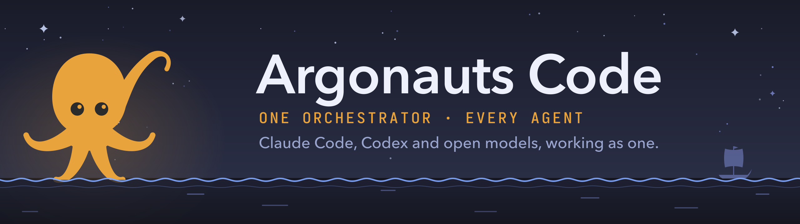
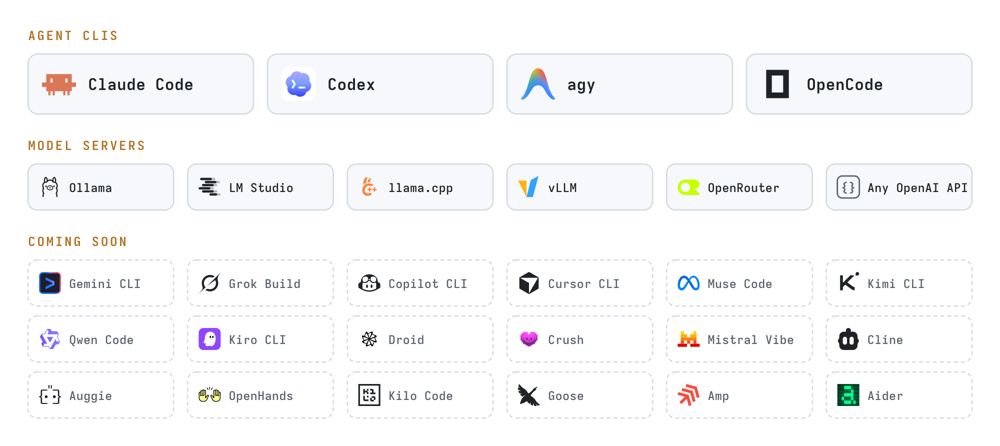

# Argonauts Code 🐙 — Every coding agent, one orchestrator, you at the helm

<div align="center">



### Orchestrate any mix of coding agents and models, from Claude Code and Codex to open-weight models on your own machine.

**Ask once. The orchestrator plans, your agents build in parallel, another reviews, and you decide what merges.**

[](LICENSE) [](#install) [](https://github.com/sheng-tse/argonauts-code/releases) [](https://github.com/sheng-tse/argonauts-code/actions/workflows/ci.yml)

**[Install](#install) · [How it works](#how-it-works) · [Workflows](#workflows) · [Agents](#supported-agents-and-models) · [Open models](#open-weight-models) · [FAQ](#faq)**

</div>

https://github.com/user-attachments/assets/36201e85-b0c6-448d-acef-7abde6d71fef

Argonauts Code is a terminal app that runs the coding agents you already use, Claude Code, Codex, agy and OpenCode, as one crew on your repository. You talk to one of them as you always do. When the work calls for it, the others plan, build in their own git worktrees and review each other's work, and nothing merges without you or the rules you set. Each CLI runs with its own sign-in and its own plan, and open-weight models join through OpenCode or straight from a server on your machine.

## Status

Alpha. 0.1.0 is the first public release: every workflow and every supported CLI below works, and more than 8,400 tests and 400 screen snapshots cover it. None of those tests calls a model; each CLI's output is recorded once and replayed. Expect rough edges, and please [report them](https://github.com/sheng-tse/argonauts-code/issues). What's missing or may change:

- Windows isn't supported yet.
- Settings and commands may change before 1.0. The [changelog](CHANGELOG.md) says how to move over.

## Why not just one agent?

One agent checking its own work brings the same blind spots it had when it wrote it. A crew splits the work from the checking:

- **A different model reviews.** Reviewers are whoever you ask for. When you ask for none, a reviewer comes from another provider than the builder where the crew has one, so Claude's work is read by GPT or Gemini, and the other way round. A workflow the main agent writes may pick its own.
- **Your checks come before the merge.** Where your settings set checks (`checks.run`, such as in a repository's `.argonauts/config.toml` once you trust it), each task must pass them before review, they run again on the exact commit you'll get, and nothing merges without you or the rules you set.
- **Work keeps going when a CLI stops.** When one agent is signed out, at its plan's limit or down, its task falls back to another, in an order you can see and change.
- **You watch it happen.** Every agent's work streams live in one workflow view, whichever CLI and model each one is.
- **It uses what you pay for.** Your Claude, ChatGPT and Google plans, your API keys, or a model running locally for free, with limits you set.

## Install

macOS (Apple silicon and Intel) and Linux (x86_64 and ARM64, with static builds for Alpine and older glibc). Windows isn't supported yet.

```sh
# macOS / Linux: the installer, no Rust needed
curl -LsSf https://github.com/sheng-tse/argonauts-code/releases/latest/download/argonauts-code-installer.sh | sh
```

```sh
# Homebrew
brew install sheng-tse/tap/argonauts-code
```

```sh
# npm, or try it without installing: npx argonauts-code
npm install -g argonauts-code
```

```sh
# crates.io, with Rust 1.95 or newer
cargo install argonauts-code --locked
```

Debian and Ubuntu (`.deb`) and Fedora (`.rpm`) packages are on each [release](https://github.com/sheng-tse/argonauts-code/releases). On Linux, the npm package unpacks the program with `xz`, so install it first if your system lacks it.

On Linux, the sandbox needs Landlock ABI 3 (kernel 6.2 or newer) and unprivileged user namespaces, and without them every agent session is refused with the reason. Ubuntu 24.04 restricts those namespaces with AppArmor: give `argonauts` an AppArmor profile, or allow them with `sudo sysctl -w kernel.apparmor_restrict_unprivileged_userns=0`. On an older kernel, `sandbox.mode = "tool"` uses each CLI's own sandbox instead.

The command is `argonauts`. You also need git and at least one agent CLI installed and signed in: [Claude Code](https://code.claude.com/docs/en/overview), [Codex](https://github.com/openai/codex), [agy](https://antigravity.google) (Google Antigravity's CLI) or [OpenCode](https://opencode.ai). Then see what it finds:

```sh
argonauts doctor
```

`doctor` lists the agent CLIs it finds and their versions, checks git, and calls no model. `/doctor` in the app also says whether each CLI is signed in.

A copy from the installer updates itself: it looks for a new release once a day and starts it at your next start (`updates.auto = false` only tells you), and `argonauts self-update` updates now, with `--rollback` to go back. A Homebrew, npm or crates.io copy updates with `brew upgrade argonauts-code`, `npm update -g argonauts-code` or `cargo install argonauts-code --locked`. To uninstall, delete `~/.local/bin/argonauts` and `~/.local/share/argonauts` (the installer's), or run `brew uninstall argonauts-code`, `npm uninstall -g argonauts-code` or `cargo uninstall argonauts-code`, and delete `~/.argonauts` if you want your settings gone too.

> [!IMPORTANT]
> Get Argonauts Code only from this repository's [releases](https://github.com/sheng-tse/argonauts-code/releases), the `sheng-tse/tap` Homebrew tap, the npm package `argonauts-code`, or the crate `argonauts-code` on crates.io (with the `argonauts-*` crates it is built from). A crate named `argonauts`, a similar repository name or a copied README isn't ours.

## Quick start

```sh
cd your-repo
argonauts
```

The first start walks you through setup: which CLIs to use, who you talk to, how the crew works, and how much it may do without asking. Then just ask, as you would ask any coding agent:

```text
❯ Fix the failing tests in tests/test_money.py without changing the tests.
```

The agent you talk to decides: small requests it answers or does itself, and bigger ones it turns into a workflow and tells you. You can also say how to run it, in the same sentence: see [Say what you want](#say-what-you-want-and-skip-the-settings).

For scripts and CI:

```sh
# One agent on one task, as its CLI would
argonauts run --captain "Add a --version flag"

# The whole crew: plan, tasks, reviews; plain lines for logs; at most $2 a task
argonauts run --crew --plain --limit-usd 2 "Add due dates to the tasks command, with tests"
```

## How it works

Three words explain most of it:

- **The main agent** is the one you talk to: any of your CLIs, on any model it runs, such as Opus on Claude Code, GPT on Codex, Gemini on agy or a local model on OpenCode. You choose the CLI in setup and its model with `/model`.
- **The crew** is everyone else it can bring in. Workers build, reviewers read changes, and a judge settles questions. Each can be a different CLI or model.
- **A workflow** says how a request gets done: who plans, who builds, who reviews, what gets checked, and when it waits for you. Argonauts Code's own code runs it, so its steps happen every time, not only when an agent remembers them.

### Say what you want, and skip the settings

You never have to set up a workflow or assign models to roles. The main agent answers small things itself. For bigger work it shapes the run: it picks a workflow or writes one for the task, then fills each role with the model it judges best for that role and that task, from the CLIs and models you have. You can steer any part of it in the same sentence as your request:

```text
❯ Add rate limiting to the API. Use GPT 6.1 Sol as the reviewer and Opus as the judge, and choose
  everything else yourself.
```

Every review in that run is GPT 6.1 Sol's and Opus is the judge, as asked. The main agent decides the rest: the workflow's structure, who builds, and how. Captain has no judge, so from Captain this request moves to one of the team workflows below (Orchestrator, Council, draft-and-vote or your own). In the same way you can say:

- **Who does what:** "Codex builds", "the reviewers use Gemini", "all the other agents on Haiku", "leave agy out".
- **How it's shaped:** "plan first", "skip the drafting phase", "work in my checkout".
- **How far it goes:** an effort level, a spend or time limit, or a goal such as "keep going until the tests pass".
- **What matters most:** "keep it cheap" or "best quality you can". The main agent weighs that when it fills the roles: lighter models for a cheap run, stronger ones and more reviewers for a careful one.

Your words apply to that one request. Say "from now on", and it offers to save them as your settings. Words can tighten safety but never loosen it, so a request can't switch off the sandbox or skip an approval you've set. `/workflow` sets your default workflow, and `/workflow try <name> <request>` previews a plan without running anything.

## Workflows

### Captain: one agent, like the CLI you know

The main agent does the work itself, in your folder, exactly as if you ran its CLI on its own. Along the way it can use its CLI's own subagents, ask another model for a quick review or a second opinion, or hand a big request to one of the workflows below, with the models and roles you named in your request, as described above.

Switch on any of these, and Captain becomes **checked**. It then works in its own worktree (a separate copy of your repo on its own branch), and the change lands only once you or the rules you set approve it:

- **Review by another provider:** for example, Codex reads Claude's change and sends it back until it passes.
- **Read back first:** the agent says what it understood and builds nothing until you or the rules you set approve it.
- **Several tries:** it builds the change a few times independently and keeps one that passes your tests.

*Good for: most requests.*

### Orchestrator: a main agent and a team

One agent plans: it splits your request into tasks. Workers build those tasks at the same time, each in its own worktree, so they never step on each other or on your checkout. Every task is reviewed by the reviewers you name or, when you name none, by another provider than its builder where the crew has one, unless a workflow the main agent writes picks its own. Then the checks your settings set run on the exact result, and nothing merges without you or the rules you set.

*Good for: features that split into parts, such as a new command, its storage and its tests.*

### Council (the default): decide first, then build

Several agents, ideally from different providers, each propose an approach without seeing the others' proposals. Then they challenge each other and decide. The chosen plan is built, reviewed and signed off. As the default, Council takes the requests big enough for a crew, and the main agent does smaller ones itself, as Captain.

*Good for: decisions with no obvious answer, such as which library to use or how to restructure something.*

### maker-checker, best-of-n and draft-and-vote

- **maker-checker:** a worker builds, and a reviewer sends it back until it holds.
- **best-of-n:** several workers try the same task, and the judge picks one.
- **draft-and-vote:** drafts, then a vote, with no critique or experiments.

*Good for: a change you want checked hard, or one worth trying more than one way.*

### Your own

A workflow is a TOML file of steps and roles, or a script. Put yours in `.argonauts/workflows/` for one repo, or in `~/.argonauts/workflows/` for every repo. The built-in workflows are written the same way, so you can copy one and change it.

## How much it does without asking

Four approval modes decide how much waits for you, and the line under the input shows which one is on. Shift+Tab cycles Supervised, Auto and Autopilot. Auto preview is a setting, such as `approvals.merge.mode = "auto_preview"`, and Shift+Tab goes on from it to Auto:

| Mode | What it means |
|---|---|
| **Supervised** | It asks you before anything that needs approval, such as a merge |
| **Auto preview** | It still asks you, and shows what auto mode would have decided, so you can see whether you'd trust it |
| **Auto** | Your rules decide, plus a judge model if you set one. Anything they can't settle waits for you |
| **Autopilot** | Nothing waits for you. The main agent answers the crew's questions, and a merge your rules approve goes through. Whatever they can't approve, or a spend or time limit, stops that part safely and keeps the work |

Two more switches:

- **Ultracode** sends every request through a workflow, small ones included. Turn it on in `/config`, or put the word "ultracode" in a request.
- **A goal** keeps the work going until something is true: `/goal all tests pass`. `/goal pause`, `/goal resume` and `/goal clear` do what they say.

Every step of every run goes to an append-only log, so a run can be resumed, replayed or reviewed afterwards (`argonauts run-review`).

## Supported agents and models

<picture>
  <source media="(prefers-color-scheme: dark)" srcset="assets/agents-dark.png">
  
</picture>

Each CLI runs as its own program, signed in your way: your Claude or ChatGPT plan, your Google account, or an API key. Argonauts Code reads each one's structured output rather than its screen. The model servers review, judge and summarize, on your machine or by API. The CLIs coming soon arrive one at a time: [tell us which you want first](https://github.com/sheng-tse/argonauts-code/issues).

`/model` picks the model each CLI runs and each role uses, and for local models it shows which ones fit your machine's memory. `argonauts models` lists every model Argonauts Code knows about.

### Open-weight models

- **To write code,** a local model runs through OpenCode, which gives it tools: install [Ollama](https://ollama.com), pull a model with tool support (for example `ollama pull qwen3-coder:30b`), and pick it for OpenCode in `/model`. Agents need a long context window, and Ollama sizes its default from your memory, so set it yourself: `OLLAMA_CONTEXT_LENGTH=65536 ollama serve`, or a Modelfile with `PARAMETER num_ctx 65536`. At 64k, Qwen3 Coder 30B takes about 25 GB. Codex's local mode (`--oss`) is supported as well.
- **To review, judge and summarize,** Argonauts Code talks to an OpenAI-compatible server directly. Ollama, LM Studio, llama.cpp's `llama-server` and vLLM are found by themselves, and any other server takes a few lines of settings.
- **When every model in the crew is local,** your code and prompts stay on your machine and the spend is $0. Argonauts Code itself never sends prompts or code. It sends one anonymous report a day (`argonauts telemetry off` stops it), looks once a day for a new release (`updates.check = false` or `ARGONAUTS_DISABLE_UPDATES=1` stops that), and reads the current model lists from this repository and Anthropic's model pages; OpenCode and your model server have network settings of their own.
- **Tested with** Qwen3 Coder 30B at a 64k window writing the code and Gemma 3 12B at 32k reviewing it, on a 64 GB laptop.

## Your screen

It follows the look and keys of Claude Code's terminal app, whichever agent you talk to:

- **The workflow view** (`/workflows`, Ctrl+T): phases, agents, tokens and time.
- **Every CLI's models in one picker.** `/model` lists Claude Code, Codex, agy and OpenCode, with each subscription's usage, then each one's models and effort, and the models your machine serves, with context, RAM and tools, and whether each one fits in memory now.
- **A mascot for each workflow** in the header: the argonaut for Captain, the medusa for Orchestrator, the hydra for Council. Ultracode turns them purple. Ghostty, kitty, WezTerm and iTerm2 draw them as pictures; other terminals draw them in blocks.
- **The agent panel and bottom line:** every agent at a glance, and your plans' usage as it goes.
- **Overview** (`/usage`, `/stats`, `/context`): usage and limits, stats from your history, and what fills each session's context.
- **What each model does differently.** Every action your agents took is a dot on the Behaviors map. Pick a model to see what it does more, in red, and less, in blue.
- **`/config`:** every setting, searchable, with `/config key=value` for one at a time.
- **`/resume` and `argonauts -c`:** carry on a conversation, a run or an agent's own session.

## Commands

| Command | What it does |
|---|---|
| `argonauts` | Open the app |
| `argonauts run` | Start a run for scripts and CI, watched in the app or as plain lines |
| `argonauts resume` | Carry on a conversation, a run, or an agent's session |
| `argonauts status` | Runs going across your repos |
| `argonauts run-review` | A run's outcome, predictions against results, and the change it proposed |
| `argonauts models` | The models Argonauts Code knows about |
| `argonauts approvals` | What waits for you, and how your approval rules have decided |
| `argonauts records`, `learned`, `skills` | Who is good at what, workflows learned from your runs, and skills to share |
| `argonauts sync` | Render AGENTS.md and CLAUDE.md from `.argonauts/conventions.md` |
| `argonauts setup`, `doctor`, `update` | Set up again, check your agent CLIs, and update them (not Argonauts Code itself) |
| `argonauts config` | Show, explain or change settings |
| `argonauts mcp serve` | Serve your runs to another agent over MCP |

## Settings

Your settings live in `~/.argonauts/config.toml`, a repository's in `.argonauts/config.toml`, and yours for one repository only in `.argonauts/config.local.toml`. A repository's settings file asks to be trusted once before its commands run.

For example, a repository's `.argonauts/config.toml`, whose checks apply once you trust the file:

```toml
workflow = "orchestrator"

[crew]
main = "claude-code"
worker = ["claude-code", "codex", "opencode/ollama/qwen3-coder:30b"]
reviewer = ["codex", "antigravity-cli", "ollama/gemma3:12b"]

[[checks.run]]
name = "tests"
command = ["cargo", "test"]
```

## Privacy and safety

- **Your CLIs, your sign-ins.** Argonauts Code starts each CLI's own program and never reads its credentials or tokens. It reads a CLI's own session transcripts only to resume, show or count that CLI's sessions, and nothing in them leaves your computer. With `ANTHROPIC_API_KEY` set, it also uses that key to ask Anthropic which models exist.
- **A sandbox for every agent:** Seatbelt on macOS, Landlock on Linux. In Auto and Autopilot agents read and write outside the project without asking, as Claude Code's and Codex's own agents can when you let them. Folders on your `PATH`, program install folders, tool configs and shell startup files are written like any other file, so an agent can `brew install` a tool or edit your `.zshrc`. In Supervised and Auto preview agents ask before they write outside the project, and a run's agents, which can't stop to ask, write only their worktree. Wherever agents work outside the project, the never-list (`outside.never`, yours to edit) holds: they never read or write your SSH, cloud and GPG keys, `.env` files, browser profiles or other CLIs' logins, and never write `/System`, `/usr` (but `/usr/local`), `/etc`, `/bin`, `/sbin`, `/lib`, `/lib32`, `/lib64` or `/libx32`. `outside.read`, `outside.write` and `outside.ask` set the modes. Agents can reach the network, so they can install packages and read docs; `sandbox.network = false` turns that off.
- **One anonymous report a day,** with no prompts, code or names in it. The first start tells you, and nothing is sent before then. Optimized builds send it, from the installer, Homebrew, npm, `cargo install` or a clone built with `--release`; a debug build never does. [PRIVACY.md](PRIVACY.md) lists every field, `argonauts telemetry show` prints the next report, and `argonauts telemetry off` or `DO_NOT_TRACK=1` stops it.
- **Limits you set** on spend, tokens and time, checked before each session starts.

## FAQ

**Does it replace Claude Code or Codex?** No, it runs them. You keep their models, tools, sign-ins and your own MCP servers, skills and plugins.

**Will this get my Claude or ChatGPT plan flagged?** Argonauts Code starts each provider's own CLI as a separate program, signed in the way you signed it in, and never reads, copies or forwards its tokens. How much automated or parallel use a plan allows is up to that plan's terms, so check yours. API keys, with limits you set, suit heavy use, and every CLI takes one.

**Does it cost more?** It uses the plans and keys you already have, and local models for free. Limits stop a run before it goes past what you set.

**Do my MCP servers work in it?** Yes, sessions it starts in Claude Code and Codex load the MCP servers you set up there, except blind sessions (independent proposals and blind reviews), which run with none on purpose.

**Can I run it on only open-weight models?** Yes, OpenCode on a local model writes the code, and a second local model reviews it.

**Does it run on Windows?** Not yet: macOS and Linux only.

**Does it need a git repository?** It works best in one, where every task gets its own worktree. In a folder that isn't one it still runs, keeping the work in place, though git itself must be installed.

## Support

Questions: [Discussions](https://github.com/sheng-tse/argonauts-code/discussions) · Bugs and ideas: [Issues](https://github.com/sheng-tse/argonauts-code/issues) · Security problems: [SECURITY.md](SECURITY.md)

## Contributing

Issues and pull requests are welcome, and [CONTRIBUTING.md](CONTRIBUTING.md) explains the setup and the checks.

## License

[Apache-2.0](LICENSE). Code adapted from other projects is credited in [NOTICE](NOTICE).

Argonauts Code is an independent project, not affiliated with, endorsed or sponsored by Anthropic, OpenAI, Google, the OpenCode team, Ollama or any other maker of a program named or pictured here. Those names and logos appear only to say which programs it works with, and remain their makers'.
